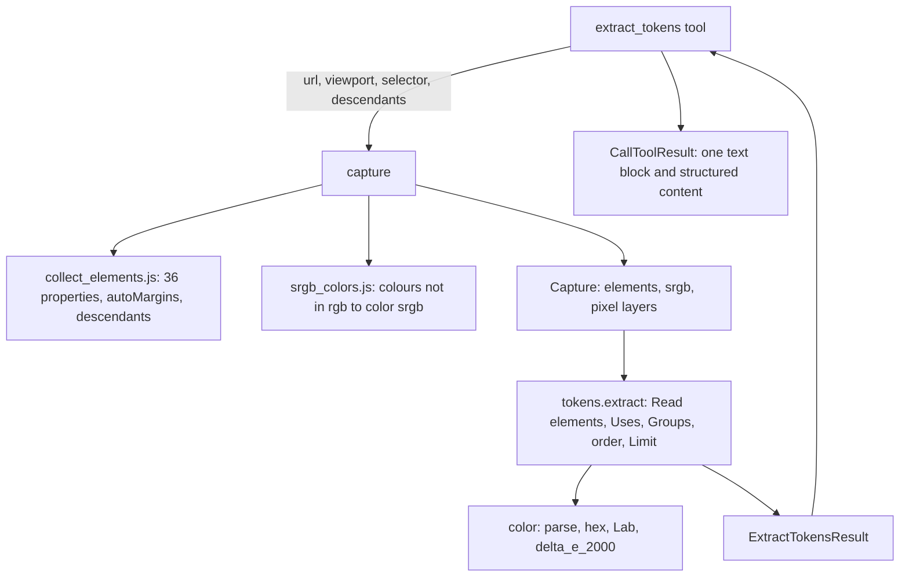

# extract-tokens Design

**Spec**: `.specs/features/extract-tokens/spec.md`
**Status**: Approved. Written on 2026-10-13 and approved as written by the maintainer the same day, AD-009 with it: the pixel layers are still taken, and the four "Points for the maintainer" stay readings of the design, with no new criterion.

---

## Architecture Overview

The tool takes one Capture and turns its elements into eight counted lists in pure Python. The browser gives three things it did not give before: twelve more computed properties for every element, the sides of an element whose margin is `auto`, and the colours it writes in another notation than `rgb()` converted by itself to sRGB. A `scope` is the selector of the Capture, which is asked for the matches and everything under them. No Check, no Finding and no pixel is read.



Three decisions change the contract of the Capture and are AD-009 in `.specs/STATE.md`: `Element.auto_margins`, `Capture.srgb` and `capture(..., descendants=True)`. The property list grows inside the contract AD-003 already set.

---

## What the spikes measured

Chromium 153.0.8010.12 through Playwright 1.63.0, on Windows, with `--disable-lcd-text`, a viewport of 1440x900 and `device_scale_factor=1`. Not run on Linux. The scripts were in the session's scratchpad and are gone; what follows is all they showed.

**No criterion of the spec was contradicted.**

| Asked | Measured | Criteria |
| --- | --- | --- |
| Computed `box-shadow` of `0 1px 3px rgba(0, 0, 0, 0.2)` | `rgba(0, 0, 0, 0.2) 0px 1px 3px 0px` | TOK-08 holds |
| Computed `box-shadow` of `0 1px 2px #000000, 0 4px 8px #000000` | `rgb(0, 0, 0) 0px 1px 2px 0px, rgb(0, 0, 0) 0px 4px 8px 0px` | TOK-38 holds |
| Computed `text-shadow` of `1px 1px 2px #000000`, on the element and on a child that inherits it | `rgb(0, 0, 0) 1px 1px 2px` on both | TOK-37 holds |
| An inset shadow | `rgb(255, 0, 0) 0px 0px 0px 1px inset, ...`: `inset` is written last | - |
| `padding: 8.5px`, `40px 40.5px`, `13.3333px` | `8.5px`, `40px` and `40.5px`, `13.3333px`: as written | TOK-48, TOK-78 hold |
| `font-size` 16.5px, 16.75px, 17.75px; `1.07rem` | `16.5px`, `16.75px`, `17.75px`; `17.12px` | TOK-45 to TOK-47 hold |
| `line-height` 20.5px, `normal`, `1.5` at 20px | `20.5px`, `normal`, `30px` | TOK-26, TOK-27, TOK-50 hold |
| Corner radii | `8px` when both radii are equal, `10px 20px`, `50%`, `30.5%`, `10.5px 20px`, `4.5px`, `0px` for none, `0px 10px`, `calc(5% + 10px)` | TOK-07, TOK-35, TOK-36, TOK-49, TOK-51 hold |
| `gap: 81px 83px` on a flex box; `gap: 91px` on a block; `gap: 10%`; no gap | `row-gap: 81px` and `column-gap: 83px`; `91px` on the block too; `10%`; `normal` | TOK-32 to TOK-34 hold; the `display` has to be read |
| `margin: 0 auto` on a box of 200px in a `body` of 1440px, the page 3,726px tall | `getComputedStyle` gives `620px` on each side: headless Chromium draws no scrollbar, so `body` stays 1440px wide | TOK-30: the 620px is right |
| The same margin through `element.computedStyleMap().get("margin-left")` | `auto`, in the light tree, in an open shadow tree and on a flex item (`400px` as laid out). A margin of `10%` reads `10%` there and `144px` as laid out; `-71px` reads `-71px` | TOK-30: this is how `auto` is told |
| Border colour of a side with no border | `border-top-color` is the element's `color` (`rgb(0, 170, 0)`) with `border-top-width: 0px` | TOK-20: the width decides |
| `-webkit-text-fill-color` | The colour of `color` when the page does not set it; `rgba(0, 0, 0, 0)` for `transparent` | TOK-16, TOK-18 hold |
| `font-weight: bold`; a quoted family | `700`; `"Helvetica Neue", Arial, sans-serif`, quotes kept | TOK-04 |
| `background-color` of `html` when only `body` sets one | `rgba(0, 0, 0, 0)` | TOK-01: white has one background Use |

### Colours

Chromium keeps a computed colour in the notation it was written in. Thirteen were read: `rgb()` and `rgba()` (every hex, named, `hsl()`, `hwb()`, system colour, `currentcolor` and `light-dark()` ends there, with whole channels), `color()` with `srgb`, `srgb-linear`, `display-p3`, `a98-rgb`, `prophoto-rgb`, `rec2020`, `xyz-d50` or `xyz-d65`, and `lab()`, `lch()`, `oklab()`, `oklch()`. A component can be `none`. `color(display-p3-linear ...)` parses too; its computed text was not read. `color-mix()` and relative colours compute to one of them (`color-mix(in srgb, ...)` to `color(srgb 0.3 0 0.7)`). An alpha of 0.001 computes to `rgba(0, 0, 0, 0)`.

Two ways to take them to sRGB were tried on 38 colours, each compared with the pixel Chromium paints for an opaque box of that colour:

| Way | Result |
| --- | --- |
| In Python, with the matrices and transfer functions of the sample code of CSS Color 4 (section 17, Editor's Draft read on 2026-10-13) | 2 of 30 opaque colours differ from the pixel. `color(rec2020 0.2 0.4 0.6)` gives `#006199` where Chromium paints `#0078a8`: the draft now gives rec2020 a plain 2.4 gamma and Chromium 153 does not. `color(display-p3 0.2 0.4 0.6)` is one step off in red (`#1b689d` for `#1a689d`), a rounding at 32 bits |
| In the page, by the browser: `fillStyle` of a detached `OffscreenCanvas` set to `color(from <text> srgb r g b / alpha)` and read back | 0 of 30 differ. `color(display-p3 1 0 0)` reads `color(srgb 1.09302 -0.22669 -0.150073)`, which clips to `#ff0000` (TOK-40); `color(srgb 0.2 0.4 0.6)` reads itself (TOK-39). A text that is no colour leaves the sentinel and reads `null`. 2,000 distinct colours take 40ms |

### ΔE2000

The function of the appendix gives the published value at four decimal places for all 34 pairs of Sharma, Wu and Dalal, in both orders of each pair; the worst error is 0.000049. With sRGB taken to Lab by the matrices of CSS Color 4 (appendix), it gives the values the spec quotes, to the digit:

| Pair | ΔE2000 | Spec |
| --- | --- | --- |
| `#1a73e8`, `#1a78e8` | 1.8554 | 1.8554 (TOK-41) |
| `#1a73e8`, `#1a79e8` | 2.2280 | 2.2280 (TOK-42) |
| `#1a78e8`, `#1a79e8` | 0.3724 | 0.3724 (TOK-42) |
| `#808080`, `#858585` | 1.8620 | 1.8620 (TOK-44) |

No two colours of `tokens-page.html` or of `tokens-scope.html` are Near. `#abcd01`, `#abcd02` and `#abcd03` (TOK-24) are Near one another (ΔE 0.02 to 0.05): the criterion holds either way, since none of the three elements is Read.

### Scope

Playwright's `css=` engine reaches into open shadow trees: `css=#deep` matches the element inside the shadow tree of `#host`. On a page shaped as `tokens-scope.html`, a collector that adds to the matches every element under them (light tree and open shadow trees) returns, for `.card`: `#one`, `#one-child`, `#two`, `#inner`, `#host`, `#deep`, each once and in document order (TOK-52, TOK-53); for `#deep`, that element alone (TOK-55); for `#gone`, one element, which is not Read (TOK-59); for `.missing`, none (TOK-57). `div[`, an empty string and a string of spaces all fail in `Locator.count()`, where `capture(...)` already raises `Invalid selector "<selector>".` with the selector it was given (TOK-58, TOK-61). The selector `:is(S), :is(S) *` returns the same six elements, but its errors would quote the composed text.

### Costs

| What | Measured |
| --- | --- |
| The collector as it is, 24 properties | 865ms for 1,004 elements, 5.35s for 5,004 (medians of 9) |
| With the twelve properties | 928ms and 5.76s: 7% to 8% more, and 37% more bytes (1.14MB to 1.56MB) |
| With the twelve properties and the margin flags | 968ms and 6.79s: 12% to 27% more than today; the smallest of the nine runs are 941ms and 5.72s |
| Converting the colours | 18ms for a page with one colour outside `rgb()`; nothing is run when there is none |
| The four screenshots of a Capture (AD-004) | 0.27s of 1.06s on a page of 1440x900; 0.48s of 1.25s at 2,050px tall; 0.71s of 1.55s at 3,726px; 0.85s of 1.9s at 5,000px: 26% to 46% of a Capture |

---

## Code Reuse Analysis

### Existing Components to Leverage

| Component | Location | How to Use |
| --- | --- | --- |
| `capture(...)` | `src/squint_mcp/capture.py:269` | Called once per call, as `inspect_element` does; its URL, load and selector errors are the messages of TOK-58, TOK-69 and TOK-70 |
| The collector | `src/squint_mcp/js/collect_elements.js` | Its `walk` already gives every element of the page its place in document order, shadow trees included; `descendants` reuses that order |
| `Element.box`, `opacity`, `computed["visibility"]` | `src/squint_mcp/models.py:87` | A Read element |
| `Element.own_text`, `own_text_boxes` | `src/squint_mcp/models.py:99` | Painted text |
| `Element.box_model` | `src/squint_mcp/models.py:37` | Margins, paddings and border widths in px, fractions kept (`parseFloat` of the computed text) |
| `inspect_element` | `src/squint_mcp/tools/inspect_element.py` | The shape of the handler: the default viewport, `asyncio.timeout`, the hand-built `CallToolResult` |
| `TOTAL_TIMEOUT_S`, `DEFAULT_VIEWPORT_*` | `src/squint_mcp/config.py` | Unchanged |
| `call`, `texts`, `fixture_url`, `client`, `local_server` | `tests/helpers.py`, `tests/conftest.py` | The tests of the tool; the page that never goes idle (TOK-73) and the patched timeout (TOK-71) are done as in `tests/test_inspect_element.py:209` and `:478` |

### Integration Points

| System | Integration Method |
| --- | --- |
| `server.py` | `server.add_tool(extract_tokens, annotations=ToolAnnotations(read_only_hint=True, open_world_hint=True))` |
| The other tools | None of their code changes. Checks build their evidence from named properties (`_EVIDENCE_PROPERTIES`) and `inspect_element` from `INSPECT_COMPUTED_PROPERTIES`, so a longer `Element.computed` reaches no response (TOK-77) |

---

## Components

### `config.py` (changed)

- **Purpose**: the properties a Capture reads, and the three thresholds of the tool with their sources (TOK-75).
- **Interfaces**:
  - `CAPTURE_COMPUTED_PROPERTIES` gains `border-top-color`, `border-right-color`, `border-bottom-color`, `border-left-color`, `border-top-left-radius`, `border-top-right-radius`, `border-bottom-right-radius`, `border-bottom-left-radius`, `box-shadow`, `text-shadow`, `row-gap`, `column-gap`.
  - `CAPTURE_COLOR_PROPERTIES`: those of the list whose computed value is one colour: `color`, `background-color`, `-webkit-text-fill-color` and the four border colours.
  - `TOKENS_NEAR_COLOR_BELOW_DELTA_E = 2.0`, `TOKENS_NEAR_LENGTH_BELOW_PX = 1.0`, `TOKENS_MAX_PER_FAMILY = 20`, each with the source the Assumptions table of the spec gives.

### `js/collect_elements.js` (changed)

- **Purpose**: one more fact per element and one more way to choose the elements.
- **Interfaces**:
  - Argument `descendants` (boolean). When true, the elements returned are the matches and every element under one of them, in the light tree and in open shadow trees, each once, in document order. The matches are walked in document order and one already added is skipped, so a match inside a match costs nothing.
  - Field `autoMargins`: the sides, among `top`, `right`, `bottom`, `left` and in that order, whose `element.computedStyleMap().get("margin-<side>").value` is `"auto"`.
- **Reuses**: `order`, `walk`, `globalThis.__squintElements` (which holds the elements returned, as today).

### `js/srgb_colors.js` (new)

- **Purpose**: have the browser convert colours to sRGB, without an element and without touching the page.
- **Interfaces**: `(texts) => (string | null)[]`. For each text: `pen.fillStyle = "#010203"`, then `pen.fillStyle = "color(from <text> srgb r g b / alpha)"`; the result is `pen.fillStyle`, or `null` when it is still the sentinel. `pen` is the 2D context of one `new OffscreenCanvas(1, 1)`.
- **Dependencies**: relative colour syntax and `OffscreenCanvas`, both in the Chromium that Playwright ships.

### `capture.py` (changed)

- **Purpose**: pass `descendants` to the collector and fill `Capture.srgb`.
- **Interfaces**:
  - `capture(session, url, viewport, selector, *, covered_text=False, fonts=False, descendants=False) -> Capture`.
  - `_srgb_colors(page, elements) -> dict[str, str]`: the distinct values of `CAPTURE_COLOR_PROPERTIES` over the elements that do not start with `rgb`, sorted, sent to `srgb_colors.js` in one call; a text the browser does not convert is left out. No call when there is none. It runs right after the collector, before the pixels: it changes nothing on the page.
- **Reuses**: the selector error of line 320, which quotes `scope` as the caller wrote it because the selector is the `scope` itself.

### `models.py` (changed)

- `Element.auto_margins: list[Literal["top", "right", "bottom", "left"]]`: "The sides whose computed margin is `auto`; `box_model.margin` holds there the margin as laid out."
- `Capture.srgb: dict[str, str]`: "The computed colours of the elements that Chromium does not write as `rgb()` or `rgba()`, each as the `color(srgb r g b)` or `color(srgb r g b / a)` the browser converts it to. A channel can be outside 0 to 1."
- `Capture.elements`: its comment gains "and, with `descendants`, every element under one of them".

### `color.py` (new)

- **Purpose**: colours as numbers. No browser code, no Capture.
- **Location**: `src/squint_mcp/color.py`
- **Interfaces**:
  - `parse(text: str) -> tuple[float, float, float, float] | None`: sRGB channels on the scale 0 to 1 and the alpha, from `rgb(r, g, b)`, `rgba(r, g, b, a)`, `color(srgb r g b)` or `color(srgb r g b / a)`; `none` is 0; `None` for any other text.
  - `to_hex(color) -> str`: each channel `floor(v * 255 + 0.5)` clipped to 0..255, the alpha rounded the same way; `#rrggbb`, or `#rrggbbaa` when the alpha is below 255.
  - `lab_of(rgb: tuple[int, int, int]) -> tuple[float, float, float]`: 8-bit sRGB to CIE Lab with a D50 white (appendix).
  - `delta_e_2000(reference, sample) -> float`: on two Lab colours (appendix). The test of TOK-74 calls this function.
- **Dependencies**: `math` only.

### `tokens.py` (new)

- **Purpose**: `Capture -> Tokens`: the Terms of the spec as code. Pure, so each rule is a few lines.
- **Location**: `src/squint_mcp/tokens.py`
- **Interfaces**:
  - `extract(capture: Capture) -> Tokens`: the eight Families and the count of Read elements.
  - The models of "Data Models" below.
- **Dependencies**: `color.py`, `config.py`, `models.py`; `ToolError` for a colour it cannot read.
- **How it works**:
  1. **Read elements**: `box.w > 0 and box.h > 0 and computed["visibility"] == "visible" and opacity > 0`.
  2. **Painted text**: `own_text and own_text_boxes`.
  3. **Uses**: for each Read element, the set of Values it has in each Role of each Family (table below). A set, so four equal sides are one Use. Counted into `{Value: {Role: uses}}` per Family.
  4. **Groups**: one function for every Family, `group(values, distance)`. The Values are walked in Rank order; `distance(a, b)` is a number when the two are Near and `None` when they are not; a Value joins the Group with the smallest distance to its Representative, the first opened on a tie (a strict `<` over the Groups in the order they were opened), and opens one when none is Near.
  5. **Tokens**: `uses` and `roles` are the sums over the Values of the Group; `variants` are its Values in Rank order.
  6. **Limit and order**: `total` is the number of Tokens. The `TOKENS_MAX_PER_FAMILY` first in Rank order (by `uses`, then by `value`) are kept and sorted in Family order.

| Family | Value, read from | Roles | Near (`distance`) | Sorts as |
| --- | --- | --- | --- | --- |
| `colors` | hex text. `text`: `computed["-webkit-text-fill-color"]` with Painted text. `background`: `computed["background-color"]`. `border`: `computed["border-<side>-color"]` where `box_model.border.<side> > 0`. Only a colour of alpha above 0 | `text`, `background`, `border` | equal alpha as 8 bits and ΔE2000 of the two `lab_of` below 2: the ΔE | text |
| `typography.families` | `computed["font-family"]`, Painted text | - | never | text |
| `typography.sizes` | px of `computed["font-size"]`, Painted text | - | px apart below 1 | number |
| `typography.weights` | number of `computed["font-weight"]`, Painted text | - | never | number |
| `typography.lineHeights` | px of `computed["line-height"]` when it ends in `px`, Painted text | - | px apart below 1 | number |
| `spacing` | px above 0. `margin`: `box_model.margin.<side>` unless the side is in `auto_margins`. `padding`: `box_model.padding.<side>`. `gap`: `computed["row-gap"]` and `computed["column-gap"]` when they are one px length and `computed["display"]` is `flex`, `inline-flex`, `grid` or `inline-grid` | `margin`, `padding`, `gap` | px apart below 1 | number |
| `radii` | the text of each of the four corner properties, unless every length in it is zero | - | both are one px length, and px apart below 1 | Lengths first, by size; then the others, by text |
| `shadows` | `("box", computed["box-shadow"])` unless `none`; `("text", computed["text-shadow"])` unless `none`, Painted text | - | never | `box` before `text`, then the text |

  A colour is read by `color.parse(capture.srgb.get(text, text))`. The distance of two px lengths is rounded to six decimal places before it is compared with 1: Chromium writes `13.3333px`, and in floating point 14.3333 minus 13.3333 is a hair under 1.

### `tools/extract_tokens.py` (new)

- **Purpose**: the tool: one Capture, `tokens.extract`, the summary.
- **Interfaces**: `async def extract_tokens(url: str, ctx: Context[BrowserSession], scope: str | None = None, viewport: Viewport | None = None) -> Annotated[CallToolResult, ExtractTokensResult]`.
- **How it works**: the selector is `"*"` when `scope is None`, else `scope` as given (an empty string is a selector, and an invalid one: never `scope or "*"`); `descendants` is `scope is not None`. The Capture is taken under `asyncio.timeout(config.TOTAL_TIMEOUT_S)`. A Capture with no element raises `Scope "<scope>" matched no elements.`. The result is one `TextContent` with the summary of TOK-10 (the `total` of each Family, `elements`, `stabilized.` or `not stabilized.`) and `structured_content=result.model_dump(mode="json", by_alias=True)`.
- **Reuses**: the handler of `inspect_element`, line for line up to the Capture.

### Documents and tests

- `README.md` and `CHANGELOG.md` (TOK-76).
- `tests/test_extract_tokens.py`, through the in-memory client; `tests/test_color.py` for TOK-74 alone; the seven fixtures of the spec; `tests/fixtures/ciede2000testdata.txt`, the file of the source, fetched raw and compared with the appendix.

---

## Data Models

Structured content, in camelCase as the other tools. Numbers are JSON numbers: Pydantic writes a `float` of 14 as `14.0`, which equals `14` for every reader.

```python
class Variant[V](BaseModel):          # V is float or str
    value: V
    uses: int

class ColorRoles(BaseModel):
    text: int
    background: int
    border: int

class SpacingRoles(BaseModel):
    margin: int
    padding: int
    gap: int

class ColorToken(BaseModel):          # colors
    value: str                        # "#rrggbb" or "#rrggbbaa"
    uses: int
    roles: ColorRoles
    variants: list[Variant[str]]

class TextToken(BaseModel):           # typography.families
    value: str
    uses: int

class NumberToken(BaseModel):         # typography.weights
    value: float
    uses: int

class LengthToken(BaseModel):         # typography.sizes, typography.lineHeights
    value: float                      # px
    uses: int
    variants: list[Variant[float]]

class SpacingToken(BaseModel):        # spacing
    value: float                      # px
    uses: int
    roles: SpacingRoles
    variants: list[Variant[float]]

class RadiusToken(BaseModel):         # radii
    value: str                        # "4px", "50%", "10px 20px"
    uses: int
    variants: list[Variant[str]]

class ShadowToken(BaseModel):         # shadows
    kind: Literal["box", "text"]
    value: str
    uses: int

class Family[T](BaseModel):
    total: int
    tokens: list[T]                   # at most TOKENS_MAX_PER_FAMILY

class Typography(BaseModel):          # camelCase: lineHeights
    families: Family[TextToken]
    sizes: Family[LengthToken]
    weights: Family[NumberToken]
    line_heights: Family[LengthToken]

class Tokens(BaseModel):              # what tokens.extract returns
    elements: int
    colors: Family[ColorToken]
    typography: Typography
    spacing: Family[SpacingToken]
    radii: Family[RadiusToken]
    shadows: Family[ShadowToken]

class ExtractTokensResult(Tokens):    # in tools/extract_tokens.py
    viewport: Viewport
    stabilized: bool
    scope: str | None
```

**Relationships**: `Tokens` is built from a `Capture` alone; the tool adds what it knows of the call.

---

## Error Handling Strategy

| Error Scenario | Handling | User Impact |
| --- | --- | --- |
| `scope` matches no element (TOK-57) | The tool, on an empty `Capture.elements` | `Scope ".missing" matched no elements.` |
| `scope` is not a selector, or is empty or blank (TOK-58, TOK-61) | `capture(...)`, at `Locator.count()`, before anything is collected | `Invalid selector "div[".`; for an empty string, `Invalid selector "".` |
| `scope` matches only elements that are not Read (TOK-59) | Not an error | `elements` 0 and eight empty Families |
| URL scheme, page that does not load (TOK-69, TOK-70) | `capture(...)`, unchanged | The messages of the other tools |
| More than 30s (TOK-71) | `asyncio.timeout` in the tool | `Timed out after 30s.` |
| The network never goes idle (TOK-73) | Not an error | `stabilized` false, `; not stabilized.` |
| A colour that is neither `rgb()` nor in `Capture.srgb` | `ToolError` from `tokens.py`: nothing is returned as partial data (AD-002) | `Unsupported colour "<text>".` No fixture reaches it: the browser converts every colour it computes |
| Any failure (TOK-72) | `ToolError` | An error result with no structured content |

---

## Risks & Concerns

| Concern | Location (file:line) | Impact | Mitigation |
| --- | --- | --- | --- |
| The collector takes about 0.87ms per element today, before this slice | `src/squint_mcp/js/collect_elements.js:13` | A page of 5,000 elements spends 5.4s of the 30s in it; this slice adds 12% to 27% to that, for every tool | Outside the slice. The measure is in AD-009 and the `ponytail:` note of that line stays. The properties are not made an argument of `capture(...)`: the maintainer decided the Capture gains no fact on request |
| A Capture takes four screenshots that this tool does not read | `src/squint_mcp/capture.py:333` | 0.3s to 0.9s per call, 26% to 46% of it | Kept (see Tech Decisions). The `ponytail:` note of that line stays, with the measure in AD-009 |
| `OffscreenCanvas` and `computedStyleMap` are those of the page's own world, as `requestAnimationFrame` is (AD-007) | `js/srgb_colors.js`, `js/collect_elements.js` | A page that replaces one of them fails every tool with an internal error; for the canvas, only when it has a colour outside `rgb()` | Accepted, as for the animation frames before their bound. Not seen on a real page |
| The Checks read a colour with a pattern for `rgb()` and `rgba()` only | `src/squint_mcp/checks/low_contrast_real.py:28`, `src/squint_mcp/checks/overlap.py:24` | What they do with a text colour in `oklch()` was not read in this session | Outside the slice. `Capture.srgb` now holds what they would need |
| The empty `scope` is refused by Playwright's selector parser, not by code of ours | `src/squint_mcp/capture.py:318` | A later Playwright that accepts `css=` with nothing after it would turn TOK-61 into a `matched no elements` error, still a failure | The test of TOK-61 asserts the failure and that the message is not a result |
| The branch for a colour the browser does not convert has no fixture | `src/squint_mcp/tokens.py` | Code no test reaches through the tool | One line that raises; named here so the Verifier does not take it for a gap of the tests |
| The fixtures count values of the default stylesheet (TOK-79 is the rule) | `tests/fixtures/tokens-*.html` | An `h1`, a `p` or a `button` in `tokens-page.html` adds margins, a border and a font the criteria do not list | Every element of the fixtures is a `div` or a `span`; `#host` of `tokens-scope.html` holds `#deep` as a block of 100px by 20px, so that it has a box (TOK-53 counts it) |

---

## Tech Decisions (only non-obvious ones)

| Decision | Choice | Rationale |
| --- | --- | --- |
| How the collector gets the twelve properties | They join `CAPTURE_COMPUTED_PROPERTIES`, for every Capture | The maintainer's decision in `context.md`. No tool reports `Element.computed` whole, so no response changes (TOK-77). Not chosen: a `properties` argument of `capture(...)`, which keeps 7% of the collector's time from the other tools and makes a Capture of two shapes |
| How an `auto` margin is told (TOK-30) | `Element.auto_margins`, read with `computedStyleMap()` | `getComputedStyle` gives the margin as laid out; the typed map gives the computed keyword. Not put in `BoxModel`, which `inspect_element` returns, nor in `Element.computed`, where a `margin-left` would mean another thing than the other names |
| Where a colour becomes sRGB (TOK-39, TOK-40) | In the page, by the browser; Python parses `rgb()` and `color(srgb ...)` and rounds to 8 bits | The Python conversion differs from what Chromium paints for `rec2020` and by one step for a `display-p3` colour; the browser's own does not differ on any of the 30 colours tried. Eleven notations, and any Chromium adds, need no code of ours. Kept in Python: the rounding, the clipping and the hex, which are the spec's rules |
| Where the converted colours live | `Capture.srgb`, one table for the Capture, filled on every Capture | A page has few distinct colours and most have none outside `rgb()`: no call is made then. Not a field of each `Element`, and not a fact on request |
| How `scope` reaches the Capture (TOK-52 to TOK-58) | The selector is the `scope`; `capture(..., descendants=True)` has the collector add what is under the matches | Errors quote the `scope` with no rewriting, and a `scope` cannot change the meaning of a composed selector. Not chosen: `:is(S), :is(S) *`, which works but needs the tool to translate two error messages |
| The pixel layers (AD-004) | Still taken | `Capture.pixels`, `background` and `ink` would become optional for every Check, under pyright, to save 0.3s to 0.9s on calls of one tool that take 1s to 2s. AD-004 names the cost for every tool and stays as it is |
| The result (AD-002) | `Annotated[CallToolResult, ExtractTokensResult]`, built by hand | AD-002 binds tools that return crops; this one returns none. Returning the model would have the SDK write its JSON as the text block, and TOK-10 wants the summary there. The pattern is that of AD-002 without the images |
| Where the code lives | `color.py` and `tokens.py` beside `vision.py`, the handler in `tools/` | `tokens.py` is not a Check: it returns no Finding. `delta_e_2000` is importable by the test of TOK-74 and by phase 4 |
| Painted text | `own_text and own_text_boxes` | The Term says "Own text, as in the Checks": a space between two inline children paints a box and is not Own text |
| Rank order of radii | A radius that is a Length sorts by size, before the others | The spec gives it for the Family order; the Term of Rank order says "numbers by size, texts by code point" and a Length is "one number of px". By code point `10px` would come before `4px` |

AD-009 in `.specs/STATE.md` records the three changes of contract and the two costs.

---

## Points for the maintainer

No criterion was contradicted, so the spec was not touched. Four places where the spec leaves a reading to the design; each could become a criterion:

1. **Rank order of radii that are Lengths** (last row above). No criterion has two radius Lengths with equal Uses in one Group.
2. **Painted text and whitespace** (row above). No fixture has an element whose only own text is the space between two inline children.
3. **Colours in the other notations.** Only `color(srgb ...)` and `color(display-p3 ...)` have criteria. Measured, for a criterion: `background-color: oklch(0.6 0.15 250)` is `#2784d5`; `color(rec2020 0.2 0.4 0.6)` is `#0078a8`; `color(srgb 0.2 0.4 0.6 / 0.5)` is `#33669980`.
4. **Lengths one pixel apart that are not exact in binary.** 13.3333px and 14.3333px are not Near with the rounding of this design; TOK-45 uses quarters, which are exact.

---

## Appendix: colour conversion and ΔE2000

Constants from the sample code of CSS Color Module Level 4, section 17 (`conversions.js`, Editor's Draft read on 2026-10-13). The function follows Sharma, Wu and Dalal (2005), with kL, kC and kH at 1.

```python
import math

D50 = (0.3457 / 0.3585, 1.0, (1.0 - 0.3457 - 0.3585) / 0.3585)

# Linear-light sRGB to CIE XYZ with sRGB's own white, D65.
SRGB_TO_XYZ = (
    (506752 / 1228815, 87881 / 245763, 12673 / 70218),
    (87098 / 409605, 175762 / 245763, 12673 / 175545),
    (7918 / 409605, 87881 / 737289, 1001167 / 1053270),
)
# Bradford chromatic adaptation from D65 to D50.
D65_TO_D50 = (
    (1.0479297925449969, 0.022946870601609652, -0.05019226628920524),
    (0.02962780877005599, 0.9904344267538799, -0.017073799063418826),
    (-0.009243040646204504, 0.015055191490298152, 0.7518742814281371),
)


def _linear(value: float) -> float:
    """An sRGB channel on 0 to 1 to linear light."""
    return value / 12.92 if value <= 0.04045 else ((value + 0.055) / 1.055) ** 2.4


def _times(matrix, v):
    return tuple(row[0] * v[0] + row[1] * v[1] + row[2] * v[2] for row in matrix)


def lab_of(rgb):
    xyz = _times(D65_TO_D50, _times(SRGB_TO_XYZ, tuple(_linear(c / 255) for c in rgb)))
    kappa, epsilon = 24389 / 27, 216 / 24389
    f = [
        math.cbrt(v) if v > epsilon else (kappa * v + 16) / 116
        for v in (xyz[0] / D50[0], xyz[1] / D50[1], xyz[2] / D50[2])
    ]
    return (116 * f[1] - 16, 500 * (f[0] - f[1]), 200 * (f[1] - f[2]))


def delta_e_2000(reference, sample):
    l1, a1, b1 = reference
    l2, a2, b2 = sample
    c_mean = (math.hypot(a1, b1) + math.hypot(a2, b2)) / 2
    g = 0.5 * (1 - math.sqrt(c_mean**7 / (c_mean**7 + 25**7)))
    a1p, a2p = (1 + g) * a1, (1 + g) * a2
    c1p, c2p = math.hypot(a1p, b1), math.hypot(a2p, b2)
    h1p = math.degrees(math.atan2(b1, a1p)) % 360 if (a1p or b1) else 0.0
    h2p = math.degrees(math.atan2(b2, a2p)) % 360 if (a2p or b2) else 0.0

    dl = l2 - l1
    dc = c2p - c1p
    if c1p * c2p == 0:
        dh = 0.0
    elif abs(h2p - h1p) <= 180:
        dh = h2p - h1p
    elif h2p - h1p > 180:
        dh = h2p - h1p - 360
    else:
        dh = h2p - h1p + 360
    dhp = 2 * math.sqrt(c1p * c2p) * math.sin(math.radians(dh / 2))

    l_mean = (l1 + l2) / 2
    cp_mean = (c1p + c2p) / 2
    if c1p * c2p == 0:
        h_mean = h1p + h2p
    elif abs(h1p - h2p) <= 180:
        h_mean = (h1p + h2p) / 2
    elif h1p + h2p < 360:
        h_mean = (h1p + h2p + 360) / 2
    else:
        h_mean = (h1p + h2p - 360) / 2
    t = (
        1
        - 0.17 * math.cos(math.radians(h_mean - 30))
        + 0.24 * math.cos(math.radians(2 * h_mean))
        + 0.32 * math.cos(math.radians(3 * h_mean + 6))
        - 0.20 * math.cos(math.radians(4 * h_mean - 63))
    )
    d_theta = 30 * math.exp(-(((h_mean - 275) / 25) ** 2))
    rc = 2 * math.sqrt(cp_mean**7 / (cp_mean**7 + 25**7))
    sl = 1 + 0.015 * (l_mean - 50) ** 2 / math.sqrt(20 + (l_mean - 50) ** 2)
    sc = 1 + 0.045 * cp_mean
    sh = 1 + 0.015 * cp_mean * t
    rt = -math.sin(math.radians(2 * d_theta)) * rc
    return math.sqrt(
        (dl / sl) ** 2 + (dc / sc) ** 2 + (dhp / sh) ** 2 + rt * (dc / sc) * (dhp / sh)
    )
```

The 34 pairs (L1, a1, b1, L2, a2, b2, ΔE00), as read through WebFetch from `https://hajim.rochester.edu/ece/sites/gsharma/ciede2000/dataNprograms/ciede2000testdata.txt` on 2026-10-13. The function above matched every row. The test file is fetched raw from that address and compared with these rows:

```text
50.0000 2.6772 -79.7751 50.0000 0.0000 -82.7485 2.0425
50.0000 3.1571 -77.2803 50.0000 0.0000 -82.7485 2.8615
50.0000 2.8361 -74.0200 50.0000 0.0000 -82.7485 3.4412
50.0000 -1.3802 -84.2814 50.0000 0.0000 -82.7485 1.0000
50.0000 -1.1848 -84.8006 50.0000 0.0000 -82.7485 1.0000
50.0000 -0.9009 -85.5211 50.0000 0.0000 -82.7485 1.0000
50.0000 0.0000 0.0000 50.0000 -1.0000 2.0000 2.3669
50.0000 -1.0000 2.0000 50.0000 0.0000 0.0000 2.3669
50.0000 2.4900 -0.0010 50.0000 -2.4900 0.0009 7.1792
50.0000 2.4900 -0.0010 50.0000 -2.4900 0.0010 7.1792
50.0000 2.4900 -0.0010 50.0000 -2.4900 0.0011 7.2195
50.0000 2.4900 -0.0010 50.0000 -2.4900 0.0012 7.2195
50.0000 -0.0010 2.4900 50.0000 0.0009 -2.4900 4.8045
50.0000 -0.0010 2.4900 50.0000 0.0010 -2.4900 4.8045
50.0000 -0.0010 2.4900 50.0000 0.0011 -2.4900 4.7461
50.0000 2.5000 0.0000 50.0000 0.0000 -2.5000 4.3065
50.0000 2.5000 0.0000 73.0000 25.0000 -18.0000 27.1492
50.0000 2.5000 0.0000 61.0000 -5.0000 29.0000 22.8977
50.0000 2.5000 0.0000 56.0000 -27.0000 -3.0000 31.9030
50.0000 2.5000 0.0000 58.0000 24.0000 15.0000 19.4535
50.0000 2.5000 0.0000 50.0000 3.1736 0.5854 1.0000
50.0000 2.5000 0.0000 50.0000 3.2972 0.0000 1.0000
50.0000 2.5000 0.0000 50.0000 1.8634 0.5757 1.0000
50.0000 2.5000 0.0000 50.0000 3.2592 0.3350 1.0000
60.2574 -34.0099 36.2677 60.4626 -34.1751 39.4387 1.2644
63.0109 -31.0961 -5.8663 62.8187 -29.7946 -4.0864 1.2630
61.2901 3.7196 -5.3901 61.4292 2.2480 -4.9620 1.8731
35.0831 -44.1164 3.7933 35.0232 -40.0716 1.5901 1.8645
22.7233 20.0904 -46.6940 23.0331 14.9730 -42.5619 2.0373
36.4612 47.8580 18.3852 36.2715 50.5065 21.2231 1.4146
90.8027 -2.0831 1.4410 91.1528 -1.6435 0.0447 1.4441
90.9257 -0.5406 -0.9208 88.6381 -0.8985 -0.7239 1.5381
6.7747 -0.2908 -2.4247 5.8714 -0.0985 -2.2286 0.6377
2.0776 0.0795 -1.1350 0.9033 -0.0636 -0.5514 0.9082
```
